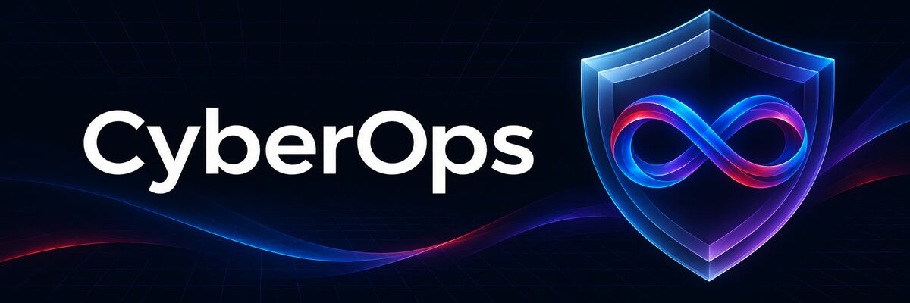

# CyberOps



## About


CyberOps coordinates Red, Blue, and Purple teams to find security gaps, guide fixes, and verify what changed. Today it operates in pre-release CI/CD and offline defensive evaluation.

## Mission

Make every release an opportunity to strengthen the defenses of software and AI systems. Give engineering and security teams the evidence to act quickly, verify their controls, and stay accountable for decisions that affect critical services.

## Product vision

CyberOps will connect preventive testing, detection, response, and learning across the software lifecycle. Red will challenge controls in authorized simulations. Blue will use trusted signals to prioritize and contain threats within approved limits. Purple will verify fixes and turn shared lessons into stronger controls.

Teams will be able to deploy each capability independently or run the teams together, choose their models and tools, and define where automation can act. Every consequential decision should be traceable to evidence, an owner, and an approval policy.

## What we’ve achieved

| Team | What ships today |
| --- | --- |
| Red | Reviews container build controls and evaluates defensive check results supplied by CI. |
| Blue | Assigns an owner, severity, and next step. The CI summary can include reviewed context about reachability, controls, identities, and data. |
| Purple | Sets a deterministic release decision, verifies fixes against a baseline, and proposes regression checks. The review ledger supplies analyst-labeled cases for offline evaluation. |

CyberOps ships standalone team plugins and a bundled, model-agnostic CLI. It supports evidence tied to a Git revision, optional signature verification, and stable finding IDs across CI runs. Production traces remain outside the current workflow. [Architecture](docs/architecture.md) · [Readiness and verification](docs/one-page-status.md)

## What we need to achieve

1. **Prove the loop on critical services.** Connect authenticated evidence producers, require a result for the exact release revision, and verify application and AI guardrail fixes in real pull requests.
2. **Show what a finding affects.** Link services, controls, identities, and data to the evidence and owner responsible for the fix.
3. **Govern live response.** Establish authenticated approvals, scoped actions, protected-service safeguards, and rollback. Validate response policies offline before deploying authorized live detection and containment.
4. **Make verified fixes last.** Carry approved lessons into regression policy and check whether findings recur across releases.
5. **Support different enterprise environments.** Extend CI and security integrations while keeping team interfaces portable and decisions auditable.

[Enterprise capability map and examples](docs/enterprise-resilience.md) · [Founding design article](https://medium.com/@bijit211987/agentic-security-framework-1c253af8a223)

## Key metrics

Track **mean time to detect**, **mean time to verified remediation**, **critical-component coverage**, **required-evidence completeness**, and **finding recurrence rate**. The local synthetic gate produced a blocked report in 55 ms median and verified the corrected fixture in 78 ms median across 20 samples per case. Enterprise detection and remediation times have yet to be measured. [Definitions and benchmark scope](docs/metrics.md)

## Operator console

[Explore the public feature portal and interactive demo](https://cyberops-platform.bijit211987.chatgpt.site).

CyberOps 0.2.0 adds a browser console and authenticated local API for finding
triage and Purple reviews. [Start the console](docs/operator-console.md)

## Initial release

[CyberOps 0.1.0](releases/v0.1.0/README.md) includes the installable Python wheel,
a checksum, and an enterprise pilot validation checklist.

## Run it locally

Use Python 3.10 or later. The default gate has no third-party Python dependencies.

```sh
python3 -m cyberops --root examples/before \
  --inventory examples/components.json --report /tmp/cyberops-before.json

python3 -m cyberops --root examples/after --baseline-root examples/before \
  --inventory examples/components.json --report /tmp/cyberops-after.json
```

The first command exits 1 with two policy findings. The second exits 0 with both rules marked resolved and lessons attached. Exit 2 indicates invalid, missing or unsupported evidence. The example digest is a placeholder for static verification. Use a verified registry digest in deployable images.

A report binds each successful assessment to SHA-256 hashes of the reviewed Dockerfiles. Differences are tracked per component and rule. A rule with one remaining occurrence stays open. Purple confirms that the static policy now passes. Application build and functional checks belong in separate CI jobs.

## Connect a repository

1. Add this project and workflow to the trusted base branch. Change `cyberops-components.json` to list actual service names, owners and repository-relative Dockerfile paths.
2. The pull request workflow reads the registered Dockerfiles as data. The engine and inventory come from the base commit, and the job checks the candidate SHA before assessment. Keep the job free of secrets, write permissions, caches and commands that execute the candidate checkout.
3. Before wiring the gate into a deployment workflow, verify on GitHub that the decision applies to the exact release revision. Require trusted candidate checks and owner review of policy, inventory and workflow changes through repository rules. The supplied workflow does not deploy.
4. Use each uploaded report during remediation review. Promote recurring lessons through reviewed changes to the rules and regression suite.

## Scope and next milestones

The Dockerfile parser supports a limited syntax and returns an error for constructs such as continuation lines, heredocs and custom parser directives. Pin checking validates the reference format, while provenance and image availability require separate evidence. The current release uses static review, trusted CI results, and remediation guidance. The default gate runs offline. An optional model adapter can add advisory explanations.

1. Map critical services and their trust boundaries to reviewed ownership and inventory entries.
2. Add defensive scanner adapters for dependency, IaC and secret findings. Require scanner freshness and artifact identity before relying on their results.
3. Validate patches through isolated builds and normal functional tests. Add trusted release-revision attestations and reviewed, expiring policy exceptions.
4. Track open, resolved and recurring findings by component. Turn approved lessons into versioned regression checks and audit evidence.

## Evaluate CI check evidence

A trusted CI producer can normalize defensive check outcomes into JSON with a
full Git commit SHA and a list of component, check and status records. Supported
statuses are `pass`, `fail` and `error`. Keep raw scanner output and logs in the
producer job. Set `required_checks` on each inventory entry to define coverage.
A failed required check blocks, and a missing or errored required check fails
closed. Purple reports a CI rule as resolved only when baseline evidence records
a failure and the candidate records a pass.

```sh
python3 -m cyberops --root examples/after --baseline-root examples/before \
  --inventory examples/evidence/components.json \
  --evidence examples/evidence/after.json \
  --revision 2222222222222222222222222222222222222222 \
  --baseline-evidence examples/evidence/before.json \
  --baseline-revision 1111111111111111111111111111111111111111 \
  --report /tmp/cyberops-evidence.json
```

The files in this example contain synthetic CI results. In a real pipeline, supply
the evidence via an artifact from a trusted producer job and the expected SHA
from trusted CI metadata. A SHA field match and content hash bind the report to
the supplied evidence. The artifact channel must establish producer identity.
The included GitHub workflow continues to use Dockerfile checks until a trusted
producer is connected.

## Reuse skills and carry lessons forward

The CLI uses `cyberops.harness.Harness`. Trusted Python callers can compose their
own harness and pass it to `run(..., harness=...)`. Red reviewers return rule and line observations from parsed Dockerfile instructions and can run with a caller-supplied executor. Blue
triage and remediation enrich those observations. The CI review skill evaluates
normalized check evidence and returns findings with rule, severity, risk, owner
and remediation. Purple's deterministic verification sets the gate. Its
replaceable learning skill receives copies of the findings and verdict.

An optional `AdvisoryModel` adapter implements `explain(findings)` and receives
only rule IDs and severities. Its text appears in the report as an advisory. The
default harness runs offline without a model. Provider configuration and request
timeouts belong in the adapter.

When Purple verifies a resolved CI finding, its lesson includes a
`suggested_required_check`. A component owner can promote it by adding an entry
such as `{"component": "example-service", "check": "guardrail-regression"}` to the
trusted `cyberops-learning.json` file. Later runs apply that requirement through
`--learning`, even if it is removed from the inventory. GitHub Actions reads
this policy from the trusted checkout. Connect the evidence producer before
promoting checks in the included workflow so CI can supply their results.

## Documentation

Use the [documentation index](docs/README.md) to find operator quickstarts,
integration contracts, architecture and readiness status.

## License

CyberOps is licensed under [Apache License 2.0](LICENSE).

## Plugin deployment modes

Use the [standalone team plugins or consolidated bundle](docs/plugins.md).
The same guide explains how to use trusted CI history to prioritize recurring findings.

- [Defensive learning benchmark and 20-point swarm roadmap](docs/defensive-learning.md)

## Install and simulate

```sh
python -m pip install -e .
cyberops-simulate --seed 42 --steps 10
docker compose run --rm simulation
```

The simulation emits a JSON audit log and decision counts for synthetic control
reviews. The container has no runtime network access. For setup, architecture,
and contributor resources, see the [documentation index](docs/README.md).
