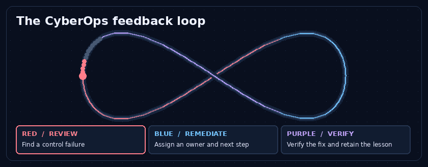

# CyberOps


**A CI security gate that turns failed controls into verified fixes.**

[](https://github.com/bijit-ghosh/CyberOps/actions/workflows/simulation.yml)
[](https://github.com/bijit-ghosh/CyberOps/actions/workflows/cyberops.yml)
[](LICENSE)

[Quickstart](#run-it-locally) · [Interactive demo](https://cyberops-platform.bijit211987.chatgpt.site/#demo) · [Packages](#releases) · [Architecture](docs/architecture.md) · [Contributing](docs/CONTRIBUTING.md) · [Security](SECURITY.md)

## About

CyberOps coordinates Red, Blue, and Purple teams around the release decision.
It explains what failed, who owns the fix, and what evidence proves resolution.
Today it operates in pre-release CI/CD and offline defensive evaluation.

## Run it locally

Clone the repository and run the synthetic AI guardrail quickstart. It uses
Python 3.10 or later and requires no third-party Python packages.

```sh
git clone https://github.com/bijit-ghosh/CyberOps.git
cd CyberOps
python3 examples/quickstart.py
```

The demo verifies an expected block, a pass on the corrected revision, and a
regression proposal. It prints the location of the two JSON reports. Use
`--output-dir` to choose a report directory. [Walk through the same finding in the browser](https://cyberops-platform.bijit211987.chatgpt.site/#demo).

## How it works



| Team | What ships today |
| --- | --- |
| Red | Reviews container build controls and evaluates defensive check results supplied by CI. |
| Blue | Assigns an owner, severity, and next step. The CI summary surfaces reviewed context about reachability, controls, identities, and data when available. |
| Purple | Issues a deterministic release decision, verifies fixes against a baseline, and proposes regression checks. The ledger supplies analyst-labeled cases for offline evaluation. |

Use the standalone team plugins or bundled CLI. Evidence is tied to a Git
revision, signatures can be verified using a trusted producer key, and stable
finding IDs connect open and resolved CI summaries. [Architecture](docs/architecture.md) · [Validation status](docs/one-page-status.md)

## Releases

- [CyberOps 0.2.0](releases/v0.2.0/README.md) includes the operator console and authenticated local API. [Start the console](docs/operator-console.md).
- [CyberOps 0.1.0](releases/v0.1.0/README.md) is the initial gate and pilot package.

## Operator console

Use the packaged console to inspect CI evidence, search findings, and record
Purple reviews. Explore the [public feature portal](https://cyberops-platform.bijit211987.chatgpt.site)
or follow the [local setup guide](docs/operator-console.md) to use your own report.

## Mission

Make each release an opportunity to strengthen the defenses of software and AI
systems. Give engineering and security teams the evidence to act quickly and
verify that their controls work.

## Product vision

Connect preventive testing, detection, governed response, and shared learning
across the software lifecycle. The next milestones are trusted evidence
producers, verification on critical services, richer control context, and durable
regression policy. Production response is outside the current release. [Capability map](docs/enterprise-resilience.md) · [Founding design article](https://medium.com/@bijit211987/agentic-security-framework-1c253af8a223)

## Key metrics

Track mean time to detect, mean time to verified remediation, critical-component
coverage, required-evidence completeness, and recurrence. Enterprise detection
and remediation times require a real-service pilot. [Definitions and synthetic benchmarks](docs/metrics.md)

## Connect a repository

1. Add this project and workflow to the trusted base branch. Change `cyberops-components.json` to list actual service names, owners and repository-relative Dockerfile paths.
2. The pull request workflow reads the registered Dockerfiles as data. The engine and inventory come from the base commit, and the job checks the candidate SHA before assessment. Keep the job free of secrets, write permissions, caches and commands that execute the candidate checkout.
3. Before wiring the gate into a deployment workflow, verify on GitHub that the decision applies to the exact release revision. Require trusted candidate checks and owner review of policy, inventory and workflow changes through repository rules. The supplied workflow does not deploy.
4. Use each uploaded report during remediation review. Promote recurring lessons through reviewed changes to the rules and regression suite.

## Scope and next milestones

The Dockerfile parser supports a limited syntax and returns an error for constructs such as continuation lines, heredocs and custom parser directives. Pin checking validates the reference format, while provenance and image availability require separate evidence. The current release uses static review, trusted CI results, and remediation guidance. The default gate runs offline. An optional model adapter can add advisory explanations.

1. Map critical services and their trust boundaries to reviewed ownership and inventory entries.
2. Add defensive scanner adapters for dependency, IaC and secret findings. Require scanner freshness and artifact identity before relying on their results.
3. Validate patches through isolated builds and normal functional tests. Add trusted release-revision attestations and reviewed, expiring policy exceptions.
4. Track open, resolved and recurring findings by component. Turn approved lessons into versioned regression checks and audit evidence.

## Evaluate CI check evidence

A trusted CI producer can normalize defensive check outcomes into JSON with a
full Git commit SHA and a list of component, check and status records. Supported
statuses are `pass`, `fail` and `error`. Keep raw scanner output and logs in the
producer job. Set `required_checks` on each inventory entry to define coverage.
A failed required check blocks, and a missing or errored required check fails
closed. Purple reports a CI rule as resolved only when baseline evidence records
a failure and the candidate records a pass.

```sh
python3 -m cyberops --root examples/after --baseline-root examples/before \
  --inventory examples/evidence/components.json \
  --evidence examples/evidence/after.json \
  --revision 2222222222222222222222222222222222222222 \
  --baseline-evidence examples/evidence/before.json \
  --baseline-revision 1111111111111111111111111111111111111111 \
  --report /tmp/cyberops-evidence.json
```

The files in this example contain synthetic CI results. In a real pipeline, supply
the evidence via an artifact from a trusted producer job and the expected SHA
from trusted CI metadata. A SHA field match and content hash bind the report to
the supplied evidence. The artifact channel must establish producer identity.
The included GitHub workflow continues to use Dockerfile checks until a trusted
producer is connected.

## Reuse skills and carry lessons forward

The CLI uses `cyberops.harness.Harness`. Trusted Python callers can compose their
own harness and pass it to `run(..., harness=...)`. Red reviewers return rule and line observations from parsed Dockerfile instructions and can run with a caller-supplied executor. Blue
triage and remediation enrich those observations. The CI review skill evaluates
normalized check evidence and returns findings with rule, severity, risk, owner
and remediation. Purple's deterministic verification sets the gate. Its
replaceable learning skill receives copies of the findings and verdict.

An optional `AdvisoryModel` adapter implements `explain(findings)` and receives
only rule IDs and severities. Its text appears in the report as an advisory. The
default harness runs offline without a model. Provider configuration and request
timeouts belong in the adapter.

When Purple verifies a resolved CI finding, its lesson includes a
`suggested_required_check`. A component owner can promote it by adding an entry
such as `{"component": "example-service", "check": "guardrail-regression"}` to the
trusted `cyberops-learning.json` file. Later runs apply that requirement through
`--learning`, even if it is removed from the inventory. GitHub Actions reads
this policy from the trusted checkout. Connect the evidence producer before
promoting checks in the included workflow so CI can supply their results.

## Documentation

Use the [documentation index](docs/README.md) to find operator quickstarts,
integration contracts, architecture and readiness status.

## License

CyberOps is licensed under [Apache License 2.0](LICENSE).

## Plugin deployment modes

Use the [standalone team plugins or consolidated bundle](docs/plugins.md).
The same guide explains how to use trusted CI history to prioritize recurring findings.

- [Defensive learning benchmark and 20-point swarm roadmap](docs/defensive-learning.md)

## Install and simulate

```sh
python -m pip install -e .
cyberops-simulate --seed 42 --steps 10
docker compose run --rm simulation
```

The simulation emits a JSON audit log and decision counts for synthetic control
reviews. The container has no runtime network access. For setup, architecture,
and contributor resources, see the [documentation index](docs/README.md).
