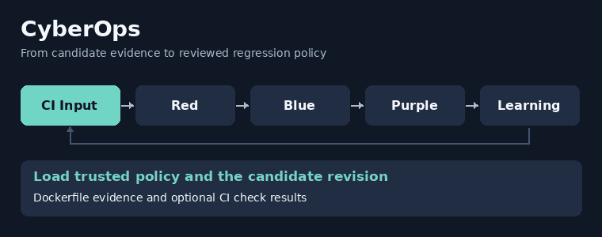
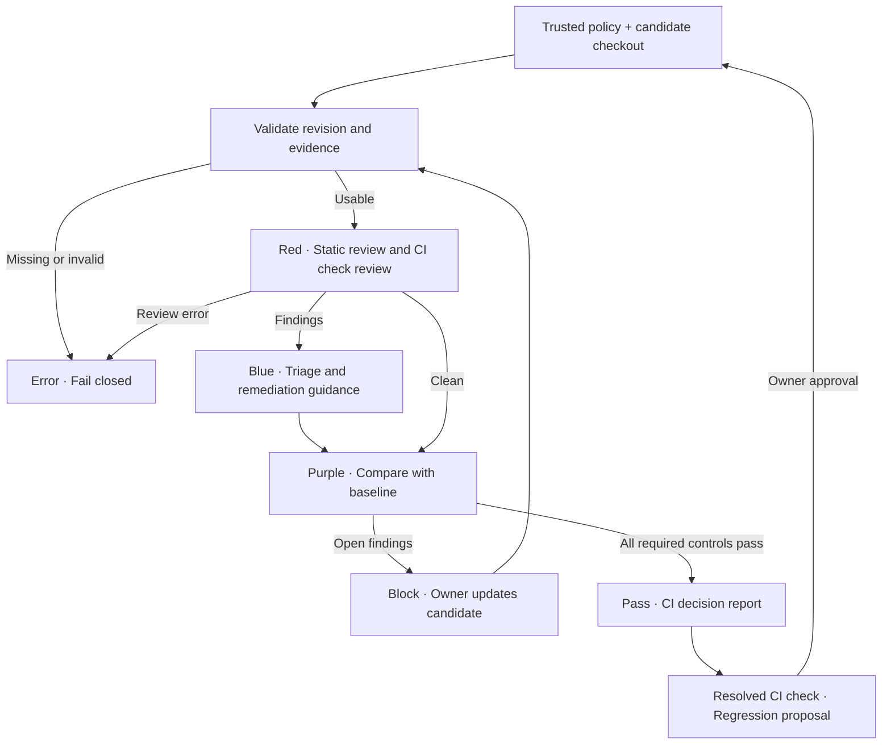

# How CyberOps works

CyberOps is a model-agnostic, offline CI security gate for registered mission-critical components. Each component has an owner, a Dockerfile path and optional required CI checks. The trusted checkout provides the executable skills, inventory and approved learning policy. The candidate checkout supplies build recipes as data. Production traces are outside the workflow.

## Follow one finding

1. **CI supplies the candidate.** The workflow checks that the candidate checkout matches the pull request head SHA. When a trusted evidence producer is connected, the CLI also checks the SHA declared in its normalized CI results and records the evidence file's digest.
2. **Red reviews controls.** Static supply-chain and final-stage identity checks run in parallel. The CI review skill evaluates required defensive check results when supplied.
3. **Blue prepares remediation.** Findings include the control, risk, severity, owner and recommended change. Owners apply changes in Git and rerun the build and defensive checks independently.
4. **Purple verifies the new result.** It compares baseline and candidate rules, records what's new, persistent or resolved, and returns pass, block or error. Missing or errored required checks fail closed.
5. **Owners promote lessons.** A resolved CI finding can produce a regression-check proposal. An approved entry in the versioned learning policy becomes a requirement on subsequent runs.

## Flowchart

## Skills and trust boundaries

| Team | Reusable skills | Handoff |
| --- | --- | --- |
| Red | Base image pinning, final-stage user review and normalized CI result review | Static observations and defensive check outcomes |
| Blue | Triage and remediation guidance | Prioritized findings with owner and recommended action |
| Purple | Deterministic verification and a replaceable learning skill | Gate verdict, baseline comparison and lessons |
 
The harness accepts trusted Python callables. A provider-neutral advisory adapter may receive rule IDs and severities and return explanatory text. The gate decision comes from deterministic verification. The current GitHub workflow exercises the built-in checks. Live normalized CI evidence requires a trusted producer and artifact channel.

See [Metrics and verification](metrics.md) for what the demo achieved and what to measure over time.
