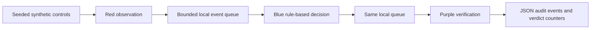

# Swarm interfaces and simulation

The [release architecture](architecture.md) describes the production-facing CI
gate. The simulator is a separate process and does not influence that gate.

An immutable envelope contains logical time, team, agent ID, control,
confidence and a role-scoped decision. A local asynchronous queue bounds
in-flight messages and gives queue operations a one-second timeout. Blue
sends unknown and low-confidence cases to review. Purple recomputes the
deterministic decision and sends disagreements to review. The event log
retains all three handoffs. Repeating the seed and step count under the
same Python environment reproduces the fixture. These thresholds and
decisions are simulation rules, not learned rewards.

## Status of the 30 requested items

| Items | Status |
| --- | --- |
| 1–4 | Apache 2.0 is the single project license. Editable packaging, ignore rules, environment template, disclosure policy, Ruff and strict type policy for the swarm package are in place. |
| 5–6 | Network-disabled Compose simulation and contributor and architecture guides are in place. The queue is in-process. |
| 7–8 | Validated typed envelope and separate bounded async queue are in place. A distributed broker and taxonomy fields remain open. |
| 9–11 | Hierarchical defensive worker scheduling, persistent memory and a Purple graph of control, evidence and mitigation remain open. |
| 12–13 | Deterministic review fallback is implemented in the simulator. Supervision, restart and heartbeat remain open. |
| 14–16 | The offline benchmark and CI gate have separate commands. PettingZoo, registry promotion and prioritized replay remain open. |
| 17–19 | Defensive evaluation still uses measured misses and fallback rates. Curriculum, defensive policy checkpoints and rollback remain open. |
| 20–24 | The simulation can only emit synthetic decisions and cannot reach a target network. Production protected-asset enforcement, authenticated approvals, mTLS/RBAC and stronger isolation remain open. |
| 25–27 | Pull-request smoke test, seeded replay and structured audit events are in place. OpenTelemetry export remains open. |
| 28–30 | JSON simulation CLI and runnable quickstart commands are in place. Live dashboards, taxonomy heatmaps and dedicated scenario scripts remain open. |
